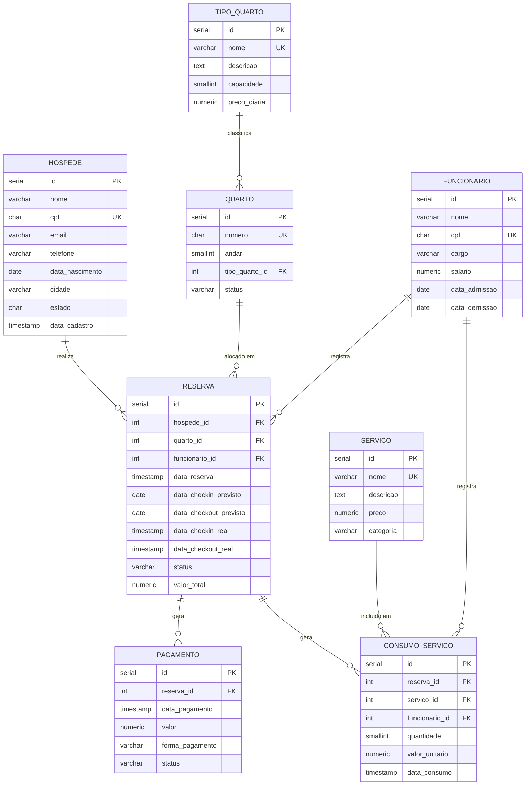

# Sistema de Gerenciamento Hoteleiro — Hotel Paraiso

> Trabalho Final — | Engenharia de Softwre I | Banco de Dados II | Programação II |
> | Ciencia da Computação | UNOESC Sao Miguel do Oeste — 2026/02 | 
> Professores: | Franciele Petry | Otilia Donato Barbosa | Roberson Junior Fernandes Alves |

---

## Resumo

O **Hotel Paraiso** e um sistema ficticio de gerenciamento hoteleiro desenvolvido como trabalho final da disciplina de Banco de Dados I. O projeto modela e implementa o banco de dados relacional que suporta o ciclo completo de uma hospedagem: desde o cadastro de hospedes e quartos ate o controle de reservas, consumo de servicos internos e pagamentos.

O modelo de dados foi projetado seguindo as regras de normalizacao ate a **Terceira Forma Normal (3FN)**, garantindo integridade referencial, eliminacao de redundancias e consistencia dos dados.

---

## Requisitos Funcionais

| ID | Descricao |
|----|-----------|
| RF01 | O sistema deve permitir o cadastro de hospedes com nome, CPF, contato e endereco |
| RF02 | O sistema deve permitir a atualizacao dos dados cadastrais de um hospede |
| RF03 | O sistema deve permitir buscar um hospede por CPF ou nome |
| RF04 | O sistema deve permitir o cadastro de tipos de quarto com capacidade e preco por diaria |
| RF05 | O sistema deve permitir o cadastro de quartos vinculados a um tipo |
| RF06 | O sistema deve permitir atualizar o status de um quarto (disponivel, ocupado, manutencao, reservado) |
| RF07 | O sistema deve permitir registrar uma reserva vinculando hospede, quarto e periodo de estadia |
| RF08 | O sistema deve permitir cancelar uma reserva ainda nao iniciada |
| RF09 | O sistema deve registrar o check-in real de uma reserva confirmada |
| RF10 | O sistema deve registrar o check-out real de uma reserva com calculo do valor total |
| RF11 | O sistema deve listar as reservas de um hospede, com filtro por status |
| RF12 | O sistema deve listar as reservas de um quarto em um periodo informado |
| RF13 | O sistema deve impedir que um quarto seja reservado em periodos sobrepostos |
| RF14 | O sistema deve permitir o cadastro de servicos oferecidos pelo hotel com nome, preco e categoria |
| RF15 | O sistema deve registrar o consumo de servicos durante uma reserva ativa |
| RF16 | O sistema deve registrar pagamentos por reserva, permitindo multiplos pagamentos parciais |
| RF17 | O sistema deve consultar o saldo pendente de pagamento de uma reserva |
| RF18 | O sistema deve emitir relatorio de taxa de ocupacao dos quartos por periodo |
| RF19 | O sistema deve emitir relatorio de hospedes mais frequentes com total de estadias e ticket medio |
| RF20 | O sistema deve emitir relatorio de faturamento mensal consolidado por forma de pagamento |

## Requisitos Nao Funcionais

| ID | Descricao |
|----|-----------|
| RNF01 | O banco de dados deve ser implementado em **PostgreSQL** (versao 14 ou superior) |
| RNF02 | O modelo deve estar normalizado ate a **3FN** |
| RNF03 | Todos os campos obrigatorios devem ser protegidos com `NOT NULL` |
| RNF04 | CPFs devem ser armazenados somente com digitos numericos e validados via `CHECK` |
| RNF05 | Valores monetarios devem usar o tipo `NUMERIC(10,2)` para precisao decimal |
| RNF06 | Datas de checkout devem ser sempre posteriores as datas de checkin (via `CHECK`) |
| RNF07 | Os status de reservas, quartos e pagamentos devem aceitar apenas valores predefinidos (`CHECK`) |
| RNF08 | Exclusoes de registros pai nao devem ser permitidas se houver registros filhos vinculados (`RESTRICT`) |
| RNF09 | O preco de um servico deve ser registrado no momento do consumo para preservar o historico financeiro |
| RNF10 | Consultas por periodo de datas devem ser suportadas por indices para garantir desempenho |

---

## Diagrama Entidade-Relacionamento



> O modelo logico detalhado com justificativas de normalizacao esta em [`docs/diagrama-relacional.md`](docs/diagrama-relacional.md).

---

## Tecnologias utilizadas

| Tecnologia | Finalidade |
|------------|------------|
| PostgreSQL 16 | Sistema Gerenciador de Banco de Dados (SGBD) |
| SQL (DDL / DML) | Criacao do esquema, constraints, indices e consultas |
| Git / GitHub | Versionamento e entrega do projeto |

---

## Estrutura do repositorio

```
bd1-exemplo-hotel/
├── docs/
│   ├── diagrama-relacional.md   # Modelo logico com cardinalidades e normalizacao
│   └── dicionario-de-dados.md  # Dicionario de dados completo (8 tabelas)
└── sql/
    ├── 01_create_database.sql   # Criacao do banco de dados
    ├── 02_create_tables.sql     # Tabelas e constraints (PK, FK, UK, CHECK, DEFAULT)
    ├── 03_indexes.sql           # Indices para otimizacao de consultas
    ├── 04_dados_exemplo.sql     # Dados de exemplo para testes
    └── 05_consultas.sql         # 8 relatorios gerenciais
```

## Como executar

Pre-requisito: PostgreSQL 14 ou superior instalado.

```bash
# 1. Cria o banco de dados
psql -U postgres -f sql/01_create_database.sql

# 2. Cria as tabelas e constraints
psql -U postgres -d hotel_paraiso -f sql/02_create_tables.sql

# 3. Cria os indices
psql -U postgres -d hotel_paraiso -f sql/03_indexes.sql

# 4. Insere dados de exemplo (opcional)
psql -U postgres -d hotel_paraiso -f sql/04_dados_exemplo.sql

# 5. Executa os relatorios
psql -U postgres -d hotel_paraiso -f sql/05_consultas.sql
```

---

## Desenvolvedores

<table>
  <tr>
    <td align="center">
      <br/>
      <strong>Fulano de Tal</strong><br/>
      Matricula: 2024001
    </td>
    <td align="center">
      <br/>
      <strong>Beltrano da Silva</strong><br/>
      Matricula: 2024002
    </td>
    <td align="center">
      <br/>
      <strong>Fulana de Tal</strong><br/>
      Matricula: 2024003
    </td>
  </tr>
</table>

---

*Disciplina: Banco de Dados I — Ciencia da Computacao — UNOESC Sao Miguel do Oeste — 2026/01*
